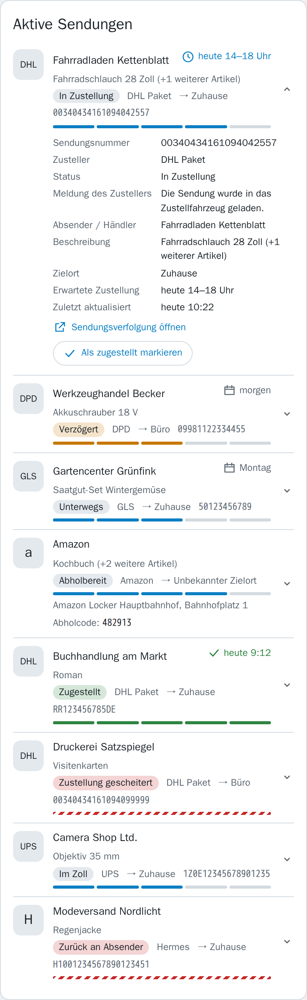
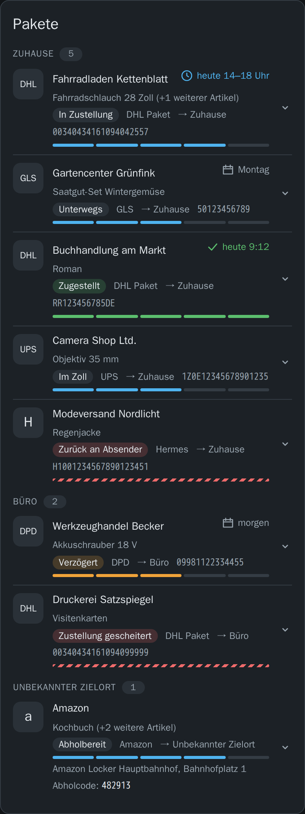

# Delivery Tracker

Home-Assistant-Custom-Integration, die Paket-Benachrichtigungen aus einem IMAP-Postfach
ausliest, den Zusteller erkennt und den Sendungsstand in Home Assistant bereitstellt.

## Funktionsumfang

- **E-Mail-Quelle:** beliebig viele IMAP-Postfächer, neue Mails per IDLE-Push sofort,
  sonst im Abfrageintervall. Der Zusteller wird über Absender, Betreff und Trackingnummer
  erkannt.
- **Zusteller:** DHL/Deutsche Post, Amazon, AliExpress, DPD, GLS, Hermes, UPS sowie ein
  generischer Fallback — jeder Zusteller ist ein Plugin.
- **Tracking-Quellen:** 17TRACK als Konto (kostenlos) oder API holt den Status direkt
  vom Zusteller (siehe [17TRACK](#17track)).
- **Zielorte:** Sendungen werden anhand der Lieferadresse einem Zielort zugeordnet, etwa
  Zuhause, Büro oder Packstation.
- **In Home Assistant:** Zähler-Sensoren mit kompakter Sendungsliste als Attribut, ein
  Kalender für erwartete Lieferungen, Actions, Events für Automationen und eine
  mitgelieferte Lovelace-Karte.

## Installation über HACS

[](https://my.home-assistant.io/redirect/hacs_repository/?owner=dominoxp&repository=ha-delivery-tracker&category=integration)

Oder von Hand:

1. In HACS auf **Integrationen → ⋮ → Benutzerdefinierte Repositories** gehen.
2. `https://github.com/dominoxp/ha-delivery-tracker` als Kategorie _Integration_ eintragen.
3. „Delivery Tracker" installieren und Home Assistant neu starten.
4. Unter **Einstellungen → Geräte & Dienste → Integration hinzufügen** nach „Delivery Tracker" suchen.

## Manuelle Installation

Das ZIP aus dem neuesten [Release](https://github.com/dominoxp/ha-delivery-tracker/releases)
nach `custom_components/delivery_tracker/` im HA-Konfigurationsverzeichnis entpacken und
Home Assistant neu starten. Das Release enthält die fertig gebaute Lovelace-Karte; wer
stattdessen den Ordner aus einem Git-Checkout kopiert, muss die Karte vorher selbst bauen
(siehe [Entwicklung](#entwicklung)).

## Einrichtung

[](https://my.home-assistant.io/redirect/config_flow_start/?domain=delivery_tracker)

Beim Hinzufügen bekommt die Integration nur einen Namen. Alles Weitere wird danach unter
**Einstellungen → Geräte & Dienste → Delivery Tracker** als eigener Eintrag angelegt:

- **Postfach hinzufügen:** Server, Port, Verschlüsselung und Zugangsdaten eines
  IMAP-Postfachs; die Verbindung wird vor dem Speichern getestet. Danach folgen Ordner
  (Standard `INBOX`), Push per IDLE, Abfrageintervall (Standard 5 Minuten) und Rückblick
  in Tagen (Standard 3, höchstens 365): So weit zurück werden beim ersten Abruf ungelesene
  Mails berücksichtigt, bei „Postfach neu einlesen" alle.
- **Zieladresse hinzufügen:** woran eine Sendung für diesen Zielort zu erkennen ist —
  Empfängernamen, Straßen mit Hausnummer, Postleitzahlen, Orte, Packstation- oder
  Filialnummern, DHL-Postnummern, Empfänger-Mailadressen und freie Schlüsselwörter.
  Mindestens eine Regel ist nötig, mehrere Einträge je Feld sind Alternativen.
  `@example.com` steht für die ganze Domain, Plus-Aliase werden erkannt. Nach dem
  Bearbeiten werden bestehende Sendungen neu zugeordnet.
- **Tracking-Quelle hinzufügen:** siehe [17TRACK](#17track).

Postfächer, Zielorte und Quellen lassen sich später über ihren Eintrag bearbeiten.
Lehnt ein Server die Zugangsdaten ab, fordert Home Assistant zur erneuten Anmeldung auf und
fragt das neue Passwort bzw. den neuen API-Schlüssel ab.

**Konfigurieren → Einstellungen** gilt für alle Postfächer und Quellen:

| Einstellung | Standard | Bedeutung |
|---|---|---|
| Aufbewahrung nach Zustellung | 14 Tage | So lange bleiben abgeschlossene Sendungen sichtbar; 0 behält sie unbegrenzt. |
| Verfall ohne Aktualisierung | 60 Tage | Sendungen ohne Aktualisierung so lange werden entfernt, auch wenn sie nie abgeschlossen wurden; 0 schaltet das ab. |
| Aktive Zusteller | alle | Mails abgeschalteter Zusteller werden nicht ausgewertet. |
| Generischer Fallback | an | Erkennt Sendungen unbekannter Zusteller anhand allgemeiner Muster. |

## Sendungen verwalten

Unter **Einstellungen → Geräte & Dienste → Delivery Tracker → Konfigurieren** gibt es neben
den Einstellungen drei weitere Punkte (der dritte, **17TRACK-Abgleich prüfen**, steht unter
[17TRACK](#17track)):

- **Sendungen ansehen und verwalten:** alle gespeicherten Sendungen, die mit der ältesten
  Mail zuerst. Jede Zeile nennt Zusteller, Status, Artikel, Zielort, wann die letzte Mail kam
  und wann die Sendung von selbst verschwindet. Markierte Sendungen lassen sich löschen oder
  als zugestellt markieren. Die Details einer Sendung zeigen alles Bekannte, warum sie noch da
  ist, ihren Statusverlauf und die Mails (Betreff, Absender), aus denen sie stammt.
  Aus der erkannten Adresse oder dem Abholort lässt sich direkt ein Zielort anlegen oder ein
  bestehender ergänzen — vorbefüllt, änderbar, mit Vorschau, welche Sendungen er bekommt.
  Ausgewählte Sendungen werden ihm fest zugeordnet.
- **Letzte Mails prüfen:** die letzten 100 verarbeiteten Mails je Postfach mit Ergebnis
  (Sendung erkannt, Zusteller erkannt aber keine Sendung, kein Zusteller, Fehler). Damit
  fallen Mails auf, die nicht erkannt wurden, etwa eine Zustellmail in neuem Format.
  **Postfach neu einlesen** wertet alle Mails im eingestellten Rückblick erneut aus, auch
  bereits gelesene.

Betreffs und Absender bleiben lokal im Store; die Diagnose-Datei enthält sie nicht.

## 17TRACK

Eine Tracking-Quelle holt den Sendungsstatus direkt vom Zusteller, auch wenn keine Mail mehr
kommt. Unter **Einstellungen → Geräte & Dienste → Delivery Tracker → Tracking-Quelle
hinzufügen** stehen zwei Varianten zur Wahl:

| | 17TRACK-Konto | 17TRACK-API |
|---|---|---|
| Kosten | **kostenlos** | **kostenpflichtig** — kleines Startkontingent, danach Jahrespakete |
| Anmeldung | E-Mail und Passwort des normalen 17TRACK-Kontos (App, 17track.net) | API-Schlüssel aus einem separaten Entwicklerkonto (api.17track.net) |
| Schnittstelle | inoffiziell, wie die HA-Core-Integration 17TRACK — kann sich ohne Vorwarnung ändern | offiziell und dokumentiert |
| Daten | letzter Stand je Sendung | volle Ereignis-Historie und Zustellfenster |

Beide tragen neue Trackingnummern aus Mails ein und übernehmen Sendungen, die nur bei 17TRACK
liegen. Zugestellte Sendungen werden im Konto archiviert bzw. bei der API abgemeldet. Bei der
API kostet jede neu angemeldete Nummer eine Einheit Kontingent; das Konto kennt kein
Kontingent. Für den privaten Haushalt ist das Konto die naheliegende Wahl.

Passt eine Nummer auf mehrere Zusteller (bei DPD und GLS üblich), legt 17TRACK keinen fest und
fragt sie nie ab — in der App müsste man den Zusteller von Hand wählen. Das übernimmt die
Konto-Quelle: Sie setzt im Konto den Zusteller aus Mail bzw. Action, im Abgleich steht dann
„Zusteller bei 17TRACK festgelegt“. Ein bereits gewählter Zusteller wird nie überschrieben.

Unter **Konfigurieren → 17TRACK-Abgleich prüfen** steht je Quelle, was der letzte Durchlauf mit
jeder Nummer gemacht hat: wird verfolgt, noch nichts gefunden, gerade eingetragen, wartet,
abgelehnt (mit nächstem Versuch), Nummer ungültig oder Zusteller abgewählt. Lehnt 17TRACK eine
Nummer ab, feuert das Event `delivery_tracker_tracking_rejected` (`source`, `tracking_number`,
`carrier`, `shipment_id`, `reason`).

Nummern ohne Mail legt die Action `delivery_tracker.add_shipment` an; sie landen immer bei
17TRACK, auch ohne gültige Prüfziffer. Den Zusteller dabei immer angeben: Viele Nummernformate
passen auf mehrere Zusteller. Fürs Dashboard reicht ein Skript mit Feldern — ein Tippen auf
seine Kachel öffnet das Formular:

```yaml
sendung_hinzufuegen:
  alias: Sendung hinzufügen
  icon: mdi:package-variant-plus
  fields:
    tracking_number:
      name: Trackingnummer
      required: true
      selector:
        text:
    carrier:
      name: Zusteller
      required: true
      selector:
        select:
          options: [dhl, dpd, gls, hermes, ups, amazon, generic]
    description:
      name: Beschreibung
      selector:
        text:
  sequence:
    - action: delivery_tracker.add_shipment
      data:
        tracking_number: "{{ tracking_number | trim }}"
        carrier: "{{ carrier }}"
        description: "{{ description | default('', true) }}"
    - action: delivery_tracker.refresh
```

## AliExpress

AliExpress liefert nicht selbst: Mehrere Bestellungen gehen zuerst als einzelne Pakete ins
Lager, werden dort zu einem Sammelpaket gebündelt und kommen zuletzt mit Hermes oder DHL.
Unterwegs bekommt das Paket jedes Mal eine neue Nummer. In der Sendungsliste steht trotzdem
**eine Zeile je Paket**:

- Nach der Bestellung erscheint sie als *bestellt*, mit Artikel und Bestellnummer.
- Sobald AliExpress ein Paket meldet, geht die Bestellung darin auf; enthält das Paket
  mehrere Bestellungen, bleibt es eine Zeile.
- Meldet AliExpress die Nummer von Hermes oder DHL, steht dieser Zusteller in der Zeile,
  mit AliExpress als Händler — eigene Mails von Hermes oder DHL landen in derselben Zeile.
- Der Status kommt aus dem Betreff, deutsch wie englisch: versandbereit, unterwegs, im
  Zielland, beim lokalen Zusteller, in Zustellung, abholbereit, Zustellproblem, zugestellt.
- „Wie war Ihr Einkaufserlebnis?" und „auf Bestätigung wird gewartet" ändern nichts: Sie
  kommen per Zeitplan, auch wenn das Paket noch nicht da ist.
- Wird eine Bestellung storniert („Your order … is closed"), verschwindet ihre Zeile —
  solange sie noch keinem Paket zugeordnet ist.

Kommt zu einer Bestellung nie eine Paketmail, bleibt sie auf *versandt*, bis sie nach der
eingestellten Frist für veraltete Sendungen von selbst verschwindet.

## Entities

Am Gerät der Integration:

| Sensor | zählt |
|---|---|
| Aktive Sendungen | alle noch nicht abgeschlossenen Sendungen |
| Alle Sendungen | zusätzlich die abgeschlossenen bis zum Ablauf der Aufbewahrung |
| Heute erwartet | aktive Sendungen, deren Zustellfenster heute liegt |
| In Zustellung | Status `out_for_delivery` |
| Abholbereit | Status `ready_for_pickup` |
| Heute zugestellt | heute zugestellte Sendungen |
| Probleme | verspätet, Zustellung gescheitert oder auf dem Rückweg |

Dazu je aktivem Zusteller ein Sensor mit dessen aktiven Sendungen und je Zielort ein Sensor
„Aktive Sendungen" am Gerät des Zielorts. Alle diese Sensoren tragen die kompakte
Sendungsliste im Attribut `shipments` sowie die Namen der Zusteller (`carriers`) und
Zielorte (`destinations`).

Als Diagnose kommen **Letzte Aktualisierung** und **Quellen** hinzu. Quellen zeigt den
schlechtesten Zustand aller Postfächer und Tracking-Quellen (OK, ausstehend, Fehler,
ausgefallen, Anmeldung abgelehnt), die Details je Quelle stehen im Attribut `sources`.

Der Kalender **Erwartete Lieferungen** trägt jede Sendung mit Termin ein, auch zugestellte
bis zum Ablauf der Aufbewahrung. Als aktuelles Ereignis zeigt er die laufende oder nächste
Lieferung.

## Actions

| Action | Zweck |
|---|---|
| `delivery_tracker.get_shipments` | Sendungen mit allen Details als Antwort; filterbar nach `status`, `carrier` und `destination` (`unknown` = ohne Zielort), mit `include_events: true` samt Verlauf. Ohne Filter alle aktiven. |
| `delivery_tracker.add_shipment` | Sendung von Hand anlegen (`tracking_number`, optional `carrier`, `destination`, `description`); eine spätere Mail ergänzt dieselbe Sendung. |
| `delivery_tracker.remove_shipment` | Sendung per `shipment_id` sofort löschen. |
| `delivery_tracker.mark_delivered` | Sendung per `shipment_id` sofort auf zugestellt setzen. |
| `delivery_tracker.refresh` | Quellen sofort abrufen, optional nur eine (`source`, Name oder ID). |
| `delivery_tracker.test_parser` | Einen Mailtext (`body`, optional `subject`, `sender`) durch alle Zusteller-Plugins schicken und Bewertung, Gewinner und erkannte Felder zurückgeben — zum Bauen neuer Regeln. |

Die `shipment_id` steht im Attribut `shipments` und in der Antwort von `get_shipments`,
etwa `dhl_00340434161094042557`. Alle Actions nehmen optional `config_entry_id`, wenn
mehrere Instanzen eingerichtet sind.

```yaml
action: delivery_tracker.get_shipments
data:
  status: [out_for_delivery, ready_for_pickup]
response_variable: pakete
```

## Events

Events feuern nur bei einer Änderung, nicht bei jedem Abruf:

| Event | Wann |
|---|---|
| `delivery_tracker_shipment_added` | Sendung zum ersten Mal gesehen |
| `delivery_tracker_shipment_updated` | Status gewechselt, mit `old_status` und `new_status` |
| `delivery_tracker_shipment_delivered` | zusätzlich, sobald der Status `delivered` wird |
| `delivery_tracker_tracking_rejected` | 17TRACK hat eine Nummer abgelehnt (siehe [17TRACK](#17track)) |

Die Sendungs-Events enthalten die kompakte Darstellung der Sendung (`id`, `carrier`,
`tracking_number`, `status`, `status_text`, `eta_start`, `eta_end`, `delivered_at`,
`destination_id`, `sender`, `description`, `pickup_location`, `pickup_code`,
`tracking_url`, `last_updated`) und `config_entry_id`.

```yaml
triggers:
  - trigger: event
    event_type: delivery_tracker_shipment_updated
    event_data:
      new_status: ready_for_pickup
actions:
  - action: notify.notify
    data:
      message: "Abholbereit: {{ trigger.event.data.description or trigger.event.data.tracking_number }} — {{ trigger.event.data.pickup_location }}"
```

## Lovelace-Karte

Die Integration bringt ihre Karte mit, liefert sie selbst aus und trägt sie beim Start als
Dashboard-Ressource ein — eine eigene HACS-Installation ist nicht nötig. Nach dem Neustart
von Home Assistant (und einem Neuladen der Seite im Browser) steht **Delivery Tracker** in
der Kartenauswahl des Dashboards. Wird die Integration gelöscht, entfernt sie auch die
Ressource wieder.

| Standard, eine Sendung aufgeklappt | Nach Zielort gruppiert, dunkles Theme |
|---|---|
|  |  |

```yaml
type: custom:delivery-tracker-card
entity: sensor.delivery_tracker_aktive_sendungen # ein Sensor der Integration
title: Pakete # optional, sonst der Name der Entity
mark_delivered: true # optional: Button „Als zugestellt / abgeholt markieren"
```

`entity` muss ein Sensor der Integration sein, also einer mit dem Attribut `shipments`.
Für aktive und zugestellte Sendungen in einer Karte eignet sich
`sensor.delivery_tracker_alle_sendungen`: Er enthält alle Sendungen, auch abgeschlossene bis
zum Ablauf der Aufbewahrungsfrist; mit `statuses` lässt sich die Liste weiter eingrenzen.
Bei ungültiger Konfiguration zeigt die Karte statt einer leeren Fläche eine Fehlermeldung.

Mit `mark_delivered: true` zeigt die Karte in den aufgeklappten Details jeder noch nicht
zugestellten Sendung neben „Sendungsverfolgung öffnen" einen Button, der die Sendung nach
einer Rückfrage über die Action `delivery_tracker.mark_delivered` als zugestellt markiert —
etwa wenn ein Paketshop die Abholung nicht meldet. Bei abholbereiten Sendungen heißt er
„Als abgeholt markieren".

Die Karte wird unter `/delivery_tracker/delivery-tracker-card.js` ausgeliefert. Ein von Hand
angelegter Ressourcen-Eintrag für diese Datei wird übernommen statt verdoppelt.

Werden die Ressourcen per YAML verwaltet (`lovelace: resource_mode: yaml`), kann die
Integration nichts eintragen. Dann die Karte selbst eintragen:

```yaml
lovelace:
  resources:
    - url: /delivery_tracker/delivery-tracker-card.js
      type: module
```

## Entwicklung

```cmd
uv venv --python 3.14
uv pip install -e ".[dev]"
check.cmd
```

`check.cmd` ist das einzige Qualitäts-Gate: `ruff format` → `ruff check` → `pytest` →
Karte (`prettier` → `eslint` → `vitest` → `vite build`). Mit `check.cmd --fix` werden
zusätzlich behebbare Lint-Fehler korrigiert.

**Karte:** Die Node-Toolchain liegt vollständig unter [card/](card/) (TypeScript, Lit,
Vite; Node 24). `check.cmd` installiert die Abhängigkeiten beim ersten Lauf selbst und
baut die Karte nach `custom_components/delivery_tracker/frontend/` — dieser Ordner ist
nicht eingecheckt, das Release baut ihn neu. Ohne installiertes Node überspringt
`check.cmd` die Karte mit einem Hinweis, die Python-Prüfungen laufen trotzdem. Einzeln:

```cmd
cd card
npm ci
npm run lint
npm test
npm run build
```

Zum Entwickeln startet `npm run dev` eine Vorschau mit Beispieldaten im Browser
([card/dev/](card/dev/)): alle Varianten der Karte, Leer- und Fehlerzustände, der
visuelle Editor und ein Umschalter für helles und dunkles Theme. Sie bindet die Quellen
direkt ein und lädt bei jeder Änderung neu; zum Build gehört sie nicht.

**Tests laufen im Docker-Container.** Home Assistant importiert seit 2025.10 die
Unix-Module `fcntl` und `resource` und lässt sich deshalb unter Windows nicht mehr
importieren. `check.cmd` baut dafür das Image aus [Dockerfile.test](Dockerfile.test)
(nur beim ersten Mal langsam, danach aus dem Layer-Cache) und startet `pytest` darin —
also auf derselben Plattform wie die GitHub-CI. Docker Desktop muss laufen.
`ruff` läuft weiterhin nativ unter Windows aus dem `.venv`.

## Lizenz

MIT
